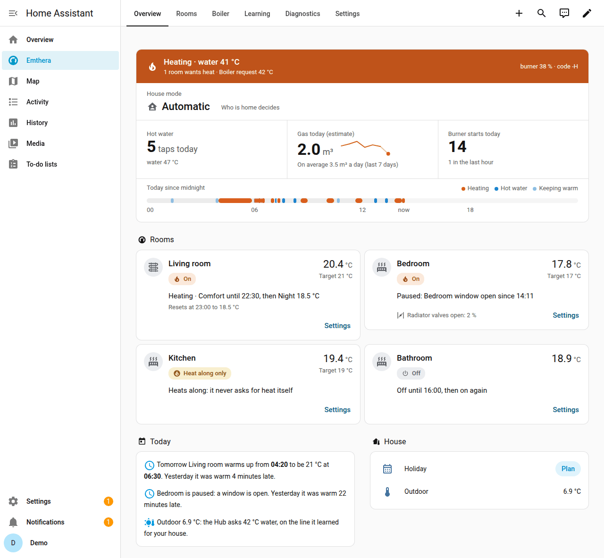
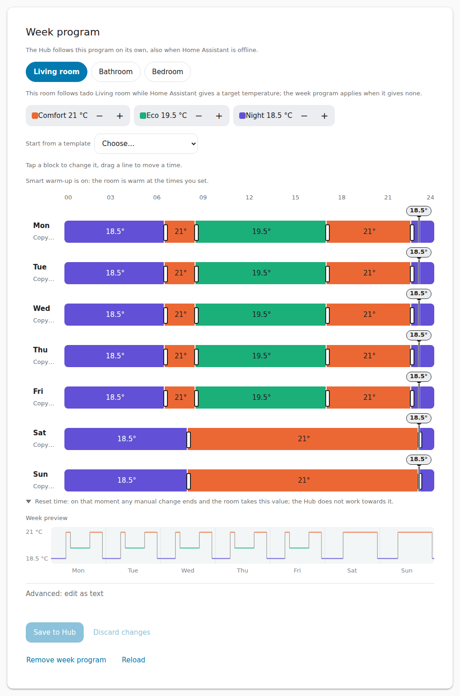
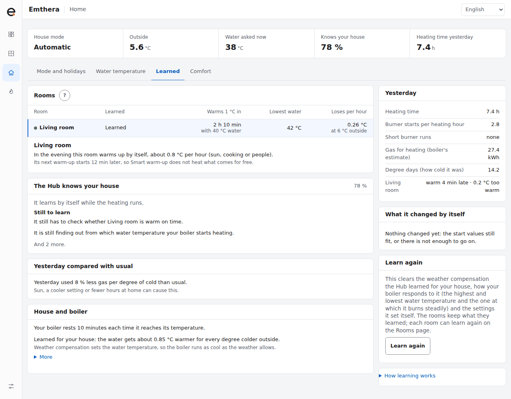
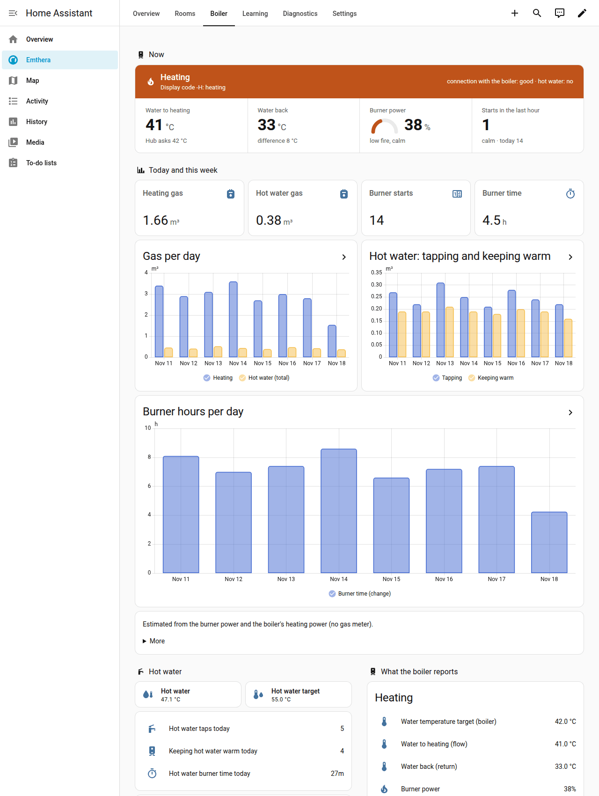
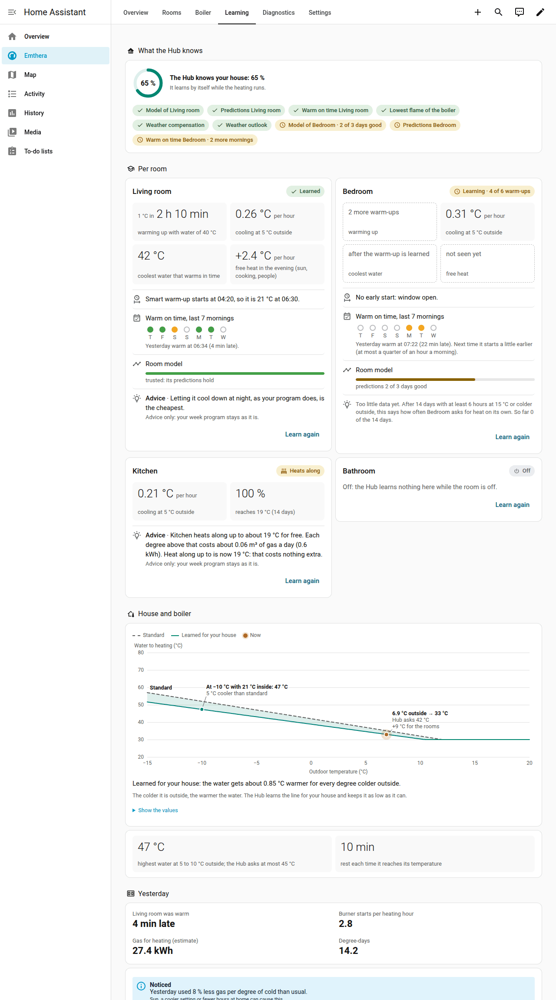
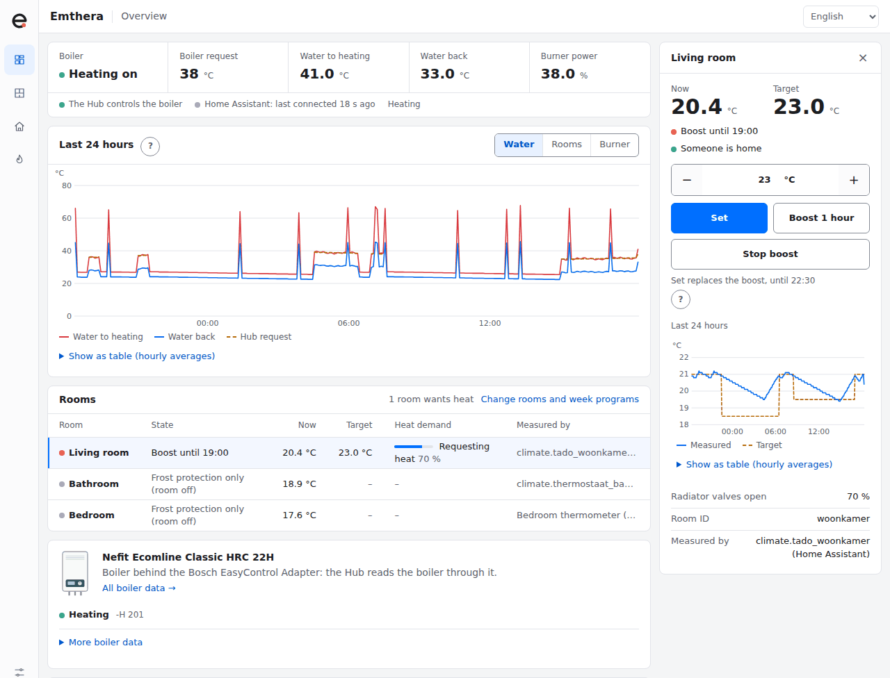
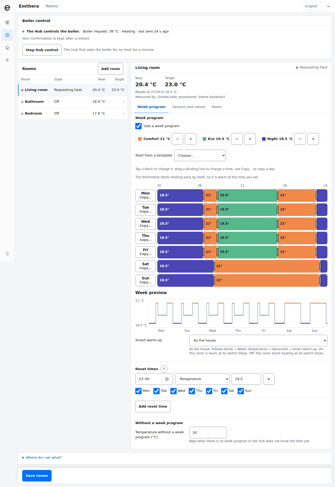
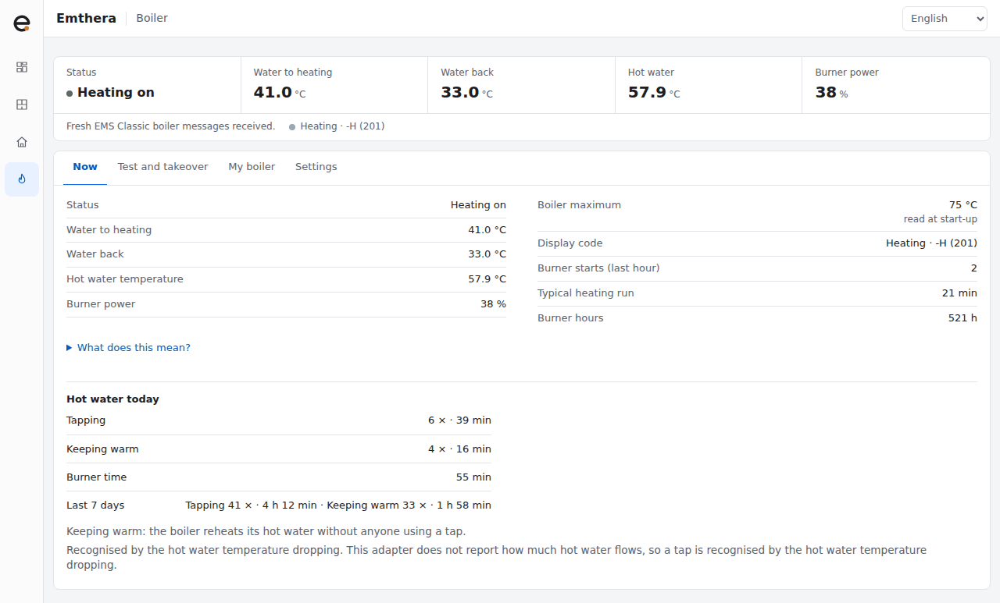
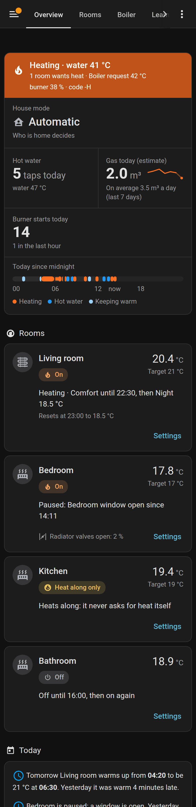
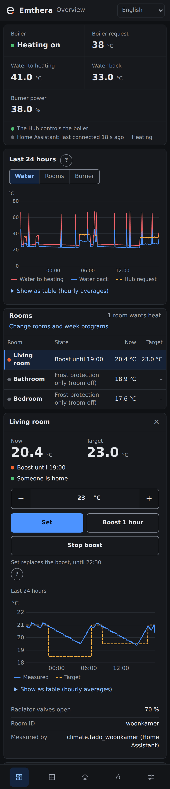

  

<a href="https://github.com/dielessen/emthera-ha">English</a> · <a href="https://github.com/dielessen/emthera-ha/blob/main/README.nl.md">Nederlands</a>

# Emthera for Home Assistant

Emthera is a thermostat for your central heating. The Hub, a small box next to your boiler, heats every room on its own
week program and learns how fast each room warms up, so it is warm when you want it. This integration brings the Hub into
Home Assistant: a thermostat per room, a week planner card, your boiler's values and a dashboard.

**Status.** The Emthera Hub is in development and not for sale yet; see [emthera.nl](https://emthera.nl). Today this
integration works with a BBQKees Gateway E32 V2 that runs Emthera firmware 1.4.6.

The heating runs in your own home and needs no cloud account.

## What you need

- A **Hub**, connected to your boiler (see Status above for what works today). The firmware is not on GitHub;
  [emthera.nl/firmware](https://emthera.nl/firmware) says where it comes from.
- A boiler: see **What is verified** below and the [boilers page](https://github.com/dielessen/emthera-ha/blob/main/docs/BOILERS.md).
- A temperature for every room: a Bluetooth thermometer, or a sensor or thermostat that is already in Home Assistant.
- **Home Assistant 2026.10.0 or newer**, with an **MQTT broker** (for example the Mosquitto add-on) and the MQTT integration.
- A 2.4 GHz Wi-Fi network or an Ethernet cable.

## What it does

**Your rooms**

- A thermostat per room with Comfort, Eco, Night and Boost.
- A week program per room, set in a planner card: drag a time, copy a day.
- Away and holiday modes: when everyone is out the rooms go cooler. A summer mode keeps the heating off and leaves hot
  water and frost protection on.
- A room can go back to a set temperature at a fixed time, or heat along only: it never asks the boiler for heat itself.
- Window and door contacts pause a room while a window is open.
- Radiator valves per room: any valve Home Assistant knows, and Zigbee2MQTT valves that the Hub drives itself.
- Optional Shelly devices for a floor pump and floor heating valves.

**Learning**

- The Hub learns per room how fast it warms up and cools down, and starts heating early enough. "What the thermostat
  has learned" says what it changed, in plain words.

**Your boiler**

- Water temperatures, pressure, burner starts and hot water use, and the boiler's display code in words. A problem
  shows up under Repairs.
- Gas use for heating and hot water, if you have a gas meter in Home Assistant.

**In Home Assistant**

- A ready-made dashboard, messages to the phones you choose, and the battery state of your sensors and valves.
- A daily backup of all the Hub's settings, which you can put back on a replacement Hub.
- Updates of the Hub's firmware from Home Assistant, in Settings → Updates.
- The Hub keeps heating on its own program when Home Assistant is offline.
- English and Dutch.

## What is verified, and what is not

- **EMS boilers** (the Bosch group: Bosch, Junkers, Buderus, Nefit): the Hub controls such a boiler after an attended
  boiler test and your own confirmation.
- **EMS+ boilers** are read, not controlled, until their model is verified. Today none is.
- **OpenTherm boilers** can be read, because they describe themselves. The Hub does not control OpenTherm boilers yet.
- The [boilers page](https://github.com/dielessen/emthera-ha/blob/main/docs/BOILERS.md) lists the families and says per family what is known: the maker says it has the
  connection, a Hub read it, or it was tested on a real boiler.

## Screenshots

These use made-up example data, not a real home.

More screenshots

## Install

1. Set up the Hub and connect it to your Wi-Fi and your MQTT broker. The
   [installation guide](https://github.com/dielessen/emthera-ha/blob/main/docs/INSTALL.md) explains how.
2. In Home Assistant, open **Settings → Marketplace**, choose **Add from link** at the top right and enter
   `https://github.com/dielessen/emthera-ha` (type **Integration** if it asks). **Add from link** needs a GitHub account connected to the
   Marketplace. Search for **Emthera**, choose **Install** and restart Home Assistant. On Home Assistant 2026.10 and
   older, do this in **HACS** (custom repository, then **Download**).
3. Go to **Settings → Devices & services → Add integration → Emthera** and follow the steps.

The Hub then guides you further. If your old thermostat is still connected, it first runs beside it for a while
without touching the boiler. Otherwise it starts with a short boiler test. It only controls your boiler after you
confirm.

## Coming from OpenThermostat?

Emthera was called OpenThermostat before. The integration has a new repository, so you do not update: you move, and
your devices, entities, history, settings, learned data and automations stay as they are. The Marketplace cannot update
an installed integration that changed its name. Do not press **Update** or **Install** on the old OpenThermostat entry.
The steps are in section 9.4 of the
[installation guide](https://github.com/dielessen/emthera-ha/blob/main/docs/INSTALL.md#94-update-from-the-release-before-the-rename-146-and-older).

## Help and more information

- [Installation guide](https://github.com/dielessen/emthera-ha/blob/main/docs/INSTALL.md) and [user guide](https://github.com/dielessen/emthera-ha/blob/main/docs/USER-GUIDE.md), with its
  [reference](https://github.com/dielessen/emthera-ha/blob/main/docs/USER-GUIDE-REFERENCE.md)
- [Boilers](https://github.com/dielessen/emthera-ha/blob/main/docs/BOILERS.md) and [devices it works with](https://github.com/dielessen/emthera-ha/blob/main/docs/DEVICES.md)
- [Release notes](https://github.com/dielessen/emthera-ha/blob/main/RELEASE-NOTES.md)

Questions or problems? [Open an issue](https://github.com/dielessen/emthera-ha/issues). It helps to add the integration's diagnostics (Settings →
Devices & services → Emthera → ⋮ → Download diagnostics) and the firmware version of the Hub.

## Open source, and what is not

This integration is open source (MIT licence, see [LICENSE](https://github.com/dielessen/emthera-ha/blob/main/LICENSE)). The Hub's firmware is not open
source. Each version here is exactly the released package of that version, checked against its SHA-256 list.

Emthera is an independent project. It is not made or supported by BBQKees Electronics. It started as
[OpenThermostat by Pawel Filipczak / intuibase](https://github.com/intuibase/open_thermostat). Further development and
releases are by Mark Dielessen.
