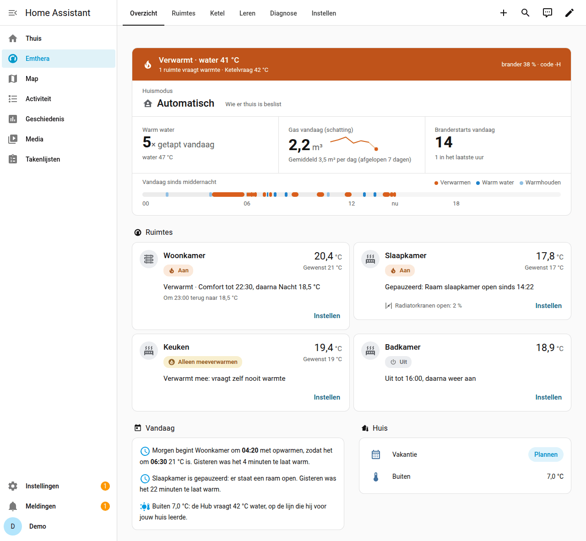
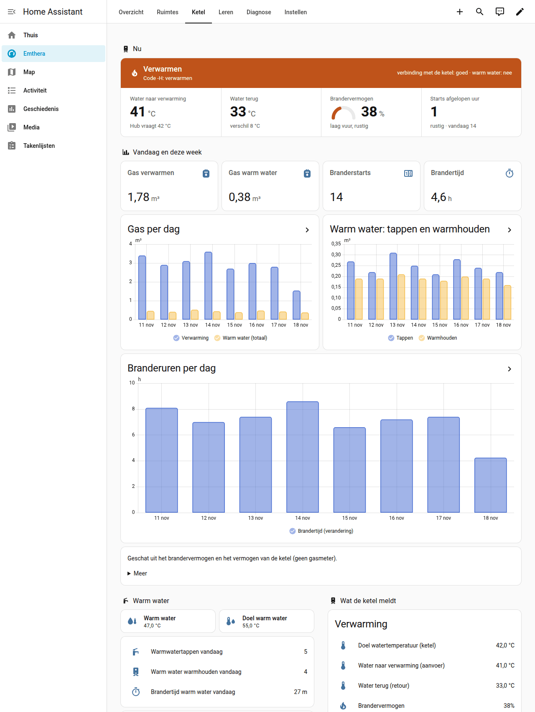
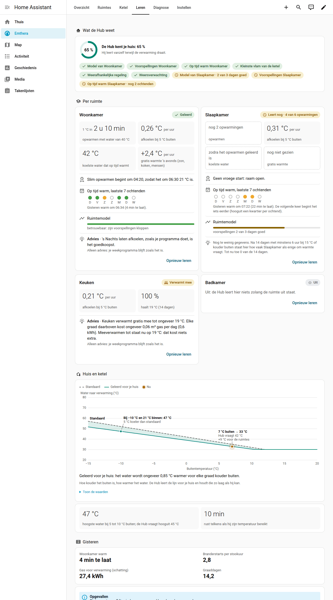
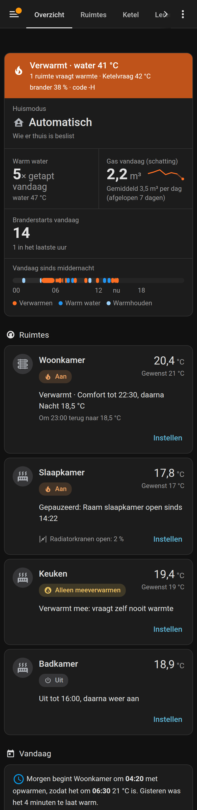

  

<a href="https://github.com/dielessen/emthera-ha">English</a> · <a href="https://github.com/dielessen/emthera-ha/blob/main/README.nl.md">Nederlands</a>

# Emthera voor Home Assistant

Emthera is een thermostaat voor je centrale verwarming. De Hub, een klein kastje naast je ketel, verwarmt elke kamer
volgens een eigen weekprogramma en leert hoe snel elke kamer opwarmt, zodat het warm is als je dat wilt. Deze
integratie brengt de Hub in Home Assistant: een thermostaat per kamer, een weekplannerkaart, de waarden van je ketel en
een dashboard.

**Status.** De Emthera Hub is in ontwikkeling en nog niet te koop; zie [emthera.nl](https://emthera.nl). Vandaag werkt
deze integratie met een BBQKees Gateway E32 V2 met Emthera-firmware 1.4.6.

De verwarming draait bij jou thuis en je hebt geen cloudaccount nodig.

## Wat je nodig hebt

- Een **Hub**, aangesloten op je ketel (zie Status hierboven voor wat vandaag werkt). De firmware staat niet op
  GitHub; op [emthera.nl/firmware](https://emthera.nl/firmware) staat waar je die vandaan haalt.
- Een ketel: zie **Wat is gecontroleerd** hieronder en de [ketelpagina](https://github.com/dielessen/emthera-ha/blob/main/docs/BOILERS.md) (Engels).
- Een temperatuur voor elke kamer: een Bluetooth-thermometer, of een sensor of thermostaat die al in Home Assistant staat.
- **Home Assistant 2026.10.0 of nieuwer**, met een **MQTT-broker** (bijvoorbeeld de Mosquitto-add-on) en de MQTT-integratie.
- Een 2,4 GHz wifi-netwerk of een netwerkkabel.

## Wat het doet

**Je kamers**

- Een thermostaat per kamer met Comfort, Eco, Nacht en Boost.
- Een weekprogramma per kamer in een plannerkaart: sleep een tijd, kopieer een dag.
- Afwezig- en vakantiestand: als iedereen weg is, gaan de kamers koeler. Een zomerstand houdt de verwarming uit en laat
  warm water en vorstbeveiliging aan.
- Een kamer kan op een vaste tijd terug naar een ingestelde temperatuur, of alleen meeverwarmen: hij vraagt dan zelf nooit
  om warmte bij de ketel.
- Raam- en deurcontacten pauzeren een kamer zolang een raam openstaat.
- Radiatorkranen per kamer: elke kraan die Home Assistant kent, en Zigbee2MQTT-kranen die de Hub zelf aanstuurt.
- Optioneel Shelly-apparaten voor een vloerpomp en vloerverwarmingskleppen.

**Leren**

- De Hub leert per kamer hoe snel hij opwarmt en afkoelt en begint op tijd met stoken. "Wat de thermostaat heeft
  geleerd" zegt in gewone woorden wat hij heeft aangepast.

**Je ketel**

- Watertemperaturen, druk, brandersstarts en warmwaterverbruik, en de displaycode van de ketel in woorden. Een
  probleem verschijnt onder Reparaties.
- Gasverbruik voor verwarming en warm water, als je een gasmeter in Home Assistant hebt.

**In Home Assistant**

- Een kant-en-klaar dashboard, berichten op de telefoons die je kiest en de batterijstand van je sensoren en kranen.
- Een dagelijkse back-up van alle instellingen van de Hub, die je op een vervangende Hub kunt terugzetten.
- Updates van de firmware van de Hub vanuit Home Assistant, in Instellingen → Updates.
- De Hub blijft op zijn eigen programma verwarmen als Home Assistant offline is.
- Engels en Nederlands.

## Wat is gecontroleerd, en wat niet

- **EMS-ketels** (de Bosch-groep: Bosch, Junkers, Buderus, Nefit): de Hub regelt zo'n ketel na een begeleide ketel-test
  en jouw eigen bevestiging.
- **EMS+-ketels** worden gelezen, niet geregeld, totdat hun model is gecontroleerd. Nu is dat nog bij geen enkel model
  het geval.
- **OpenTherm-ketels** kunnen worden gelezen, want ze beschrijven zichzelf. De Hub regelt nog geen OpenTherm-ketels.
- De [ketelpagina](https://github.com/dielessen/emthera-ha/blob/main/docs/BOILERS.md) (Engels) noemt de families en zegt per familie wat bekend is: de maker zegt dat hij
  de aansluiting heeft, een Hub heeft hem gelezen, of hij is getest op een echte ketel.

## Schermafbeeldingen

Deze gebruiken verzonnen voorbeeldgegevens, geen echt huis.

Meer schermafbeeldingen

## Installeren

1. Zet de Hub klaar en verbind hem met je wifi en je MQTT-broker. De [installatiegids](https://github.com/dielessen/emthera-ha/blob/main/docs/INSTALL.md) (Engels)
   legt uit hoe.
2. Open in Home Assistant **Instellingen → Marketplace**, kies rechtsboven **Toevoegen via link** en vul
   `https://github.com/dielessen/emthera-ha` in (type **Integration** als hij ernaar vraagt). **Toevoegen via link** vraagt een GitHub-account dat met
   de Marketplace is verbonden. Zoek **Emthera**, kies **Installeren** en herstart Home Assistant. Op Home Assistant
   2026.10 en ouder doe je dit in **HACS** (aangepaste repository, daarna **Downloaden**).
3. Ga naar **Instellingen → Apparaten en diensten → Integratie toevoegen → Emthera** en volg de stappen.

De Hub begeleidt je daarna verder. Zit je oude thermostaat er nog op, dan draait hij eerst een tijd ernaast zonder de
ketel aan te raken. Anders begint hij met een korte ketel-test. Hij regelt je ketel pas nadat je dat bevestigt.

## Kom je van OpenThermostat?

Emthera heette eerst OpenThermostat. De integratie heeft een nieuwe repository, dus je werkt niet bij: je verhuist, en
je apparaten, entiteiten, geschiedenis, instellingen, geleerde gegevens en automatiseringen blijven zoals ze zijn. De
Marketplace kan een geïnstalleerde integratie die van naam is veranderd niet bijwerken. Kies **Bijwerken** of
**Installeren** niet op de oude OpenThermostat-vermelding. De stappen staan in hoofdstuk 9.4 van de
[installatiegids](https://github.com/dielessen/emthera-ha/blob/main/docs/INSTALL.md#94-update-from-the-release-before-the-rename-146-and-older) (Engels).

## Hulp en meer informatie

- [Installatiegids](https://github.com/dielessen/emthera-ha/blob/main/docs/INSTALL.md) en [gebruikershandleiding](https://github.com/dielessen/emthera-ha/blob/main/docs/USER-GUIDE.md) (Engels), met de
  [naslag](https://github.com/dielessen/emthera-ha/blob/main/docs/USER-GUIDE-REFERENCE.md)
- [Ketels](https://github.com/dielessen/emthera-ha/blob/main/docs/BOILERS.md) en [apparaten waarmee het werkt](https://github.com/dielessen/emthera-ha/blob/main/docs/DEVICES.nl.md)
- [Release-opmerkingen](https://github.com/dielessen/emthera-ha/blob/main/RELEASE-NOTES.md) (Engels)

Vragen of problemen? [Open een issue](https://github.com/dielessen/emthera-ha/issues). Het helpt om de diagnostiek van de integratie (Instellingen →
Apparaten en diensten → Emthera → ⋮ → Diagnostiek downloaden) en de firmwareversie van de Hub erbij te zetten.

## Open source, en wat niet

Deze integratie is open source (MIT-licentie, zie [LICENSE](https://github.com/dielessen/emthera-ha/blob/main/LICENSE)). De firmware van de Hub is
niet open source. Elke versie hier is precies het uitgebrachte pakket van die versie, gecontroleerd met zijn
SHA-256-lijst.

Emthera is een onafhankelijk project. Het is niet gemaakt of ondersteund door BBQKees Electronics. Het begon als
[OpenThermostat van Pawel Filipczak / intuibase](https://github.com/intuibase/open_thermostat). Verdere ontwikkeling en
releases zijn van Mark Dielessen.
